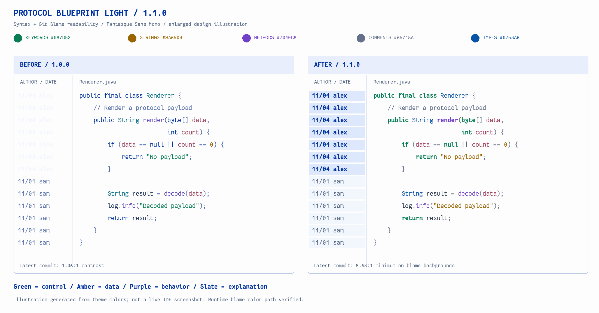

# Protocol Blueprint Light

Complete light themes for **JetBrains IDEA** and **Visual Studio Code**, inspired by [Protocol Explorer](https://protocol-explorer-alpha.vercel.app/): near-white paper, cobalt-blue controls, fine borders, and distinct syntax colors.

面向 IDEA 与 VS Code 的完整浅色主题。字体预设为 **Fantasque Sans Mono · 13 · line spacing 1.2**；字体需自行安装，已有用户设置优先。

## Platforms / 平台目录

| Platform | Source | Installation / build |
| --- | --- | --- |
| JetBrains IDEA | [`idea/`](idea/) | [IDEA instructions](idea/README.md) |
| Visual Studio Code | [`vscode/`](vscode/) | [VS Code instructions](vscode/README.md) |

The two platforms have independent manifests and theme resources. No application source code, credentials, bundled fonts, or website artwork is included.

## Install

Download the platform-specific package from [Releases](https://github.com/Suremotoo/protocol-blueprint-light/releases).

- **IDEA:** Plugins → Install Plugin from Disk → select the IDEA ZIP. Appearance → Theme → **Protocol Blueprint Light**. Editor → Color Scheme → **Protocol Blueprint Light 1.1**. Requires Islands Light / build 253+.
- **VS Code:** Extensions: Install from VSIX → select the VSIX. Preferences: Color Theme → **Protocol Blueprint Light**.

## Colors

Green keywords, amber strings and numbers, purple methods, blue types, rose parameters, and slate comments. Git Blame has explicit readable foregrounds. See [palette.json](palette.json).



This is a palette illustration, not an IDE screenshot. [Design notes](docs/design-notes.md) and [verification scope](docs/VERIFICATION.md) document the implementation and its limits.

## Build

Python 3.9+ builds the IDEA resource plugin without a JDK or Gradle:

```sh
python3 scripts/build.py idea
```

Node.js 20+ / npm are additionally required for the VS Code package:

```sh
python3 scripts/build.py vscode
# or both:
python3 scripts/build.py all
```

Artifacts and SHA-256 checksums are written to `dist/`; generated packages are excluded from Git.

## License and attribution

[MIT](LICENSE), Copyright © 2026 Suremotoo. Visual inspiration: Protocol Explorer, credited on the site to DilumSanJaya. Original theme resources; no website illustrations or JetBrains native assets are redistributed. Fantasque Sans Mono is not bundled.
