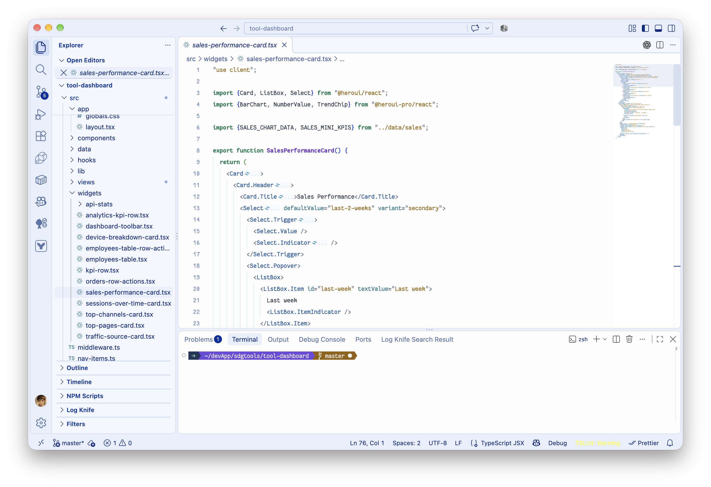
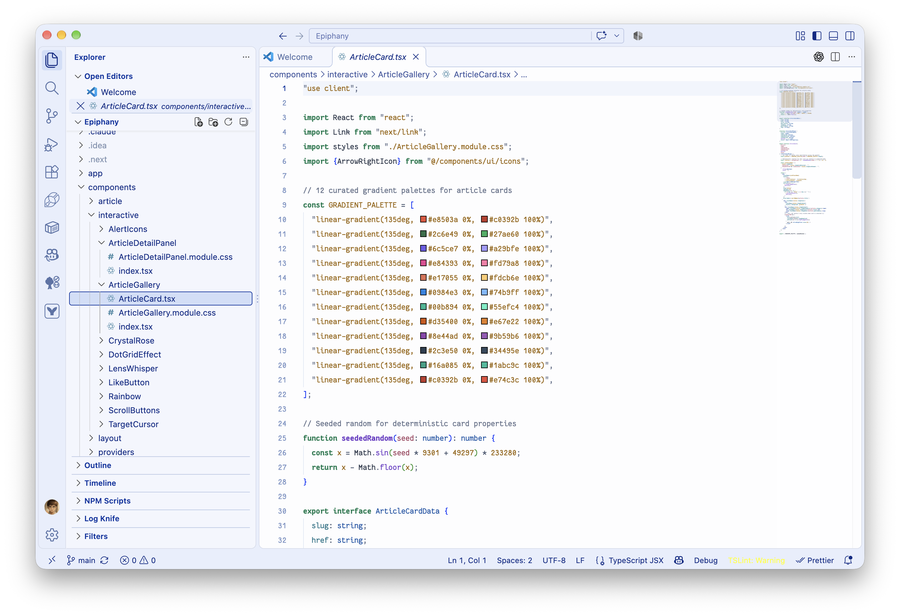
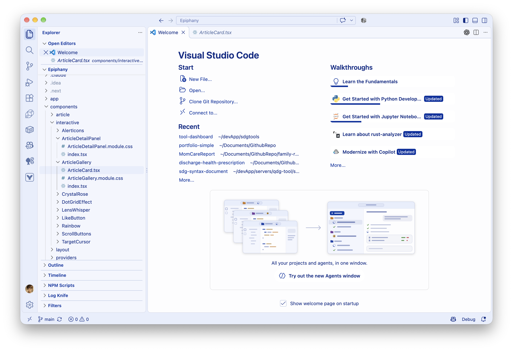

# Protocol Blueprint Light

A complete light theme for Visual Studio Code: near-white paper, cobalt-blue controls, fine borders, and softly tinted panels. Inspired by engineering blueprints and [Protocol Explorer](https://protocol-explorer-alpha.vercel.app/).

## Screenshots

### TypeScript / React and terminal



### Syntax details



### Workbench



These are actual VS Code screenshots supplied by the theme author. File icons, terminal prompts, and additional extension decorations depend on the extensions and shell installed on your system.

## Install and activate

1. Install **Protocol Blueprint Light** from the Visual Studio Marketplace.
2. Open **Preferences: Color Theme** from the Command Palette.
3. Select **Protocol Blueprint Light**.

Alternatively, download the VSIX from [GitHub Releases](https://github.com/Suremotoo/protocol-blueprint-light/releases) and run **Extensions: Install from VSIX**.

## Colors

- Green keywords; amber strings and numbers.
- Purple methods; blue types; rose parameters; teal properties.
- Slate comments, with neutral dark text for ordinary code.
- Cobalt-blue interface controls, subtle blue borders, and near-white editor backgrounds.
- Explicit colors for built-in Git Blame, CodeLens, and optional GitLens annotations.

## Font presets

Install **Fantasque Sans Mono** separately. The extension provides these defaults:

```json
{
  "editor.fontFamily": "'Fantasque Sans Mono', monospace",
  "editor.fontSize": 13,
  "editor.lineHeight": 1.2,
  "editor.fontLigatures": true,
  "terminal.integrated.fontFamily": "Fantasque Sans Mono",
  "terminal.integrated.fontSize": 13,
  "terminal.integrated.lineHeight": 1.2
}
```

Existing user and workspace settings take precedence. Font defaults apply while the extension is enabled, including when another theme is selected. VS Code rounds a 1.2 line-height multiplier to about 16 px at size 13. Custom token or workbench color settings may override the theme.

## Source and companion IDEA theme

The [GitHub repository](https://github.com/Suremotoo/protocol-blueprint-light) keeps `vscode/` and `idea/` separate. The companion [JetBrains theme](https://plugins.jetbrains.com/plugin/35816-protocol-blueprint-light) uses Islands Light.

To build this extension from the repository root: `python3 scripts/build.py vscode` (Python 3.9+, Node.js 20+, npm). Output is written to `dist/`.

[Report an issue](https://github.com/Suremotoo/protocol-blueprint-light/issues). MIT license; fonts are not bundled.
