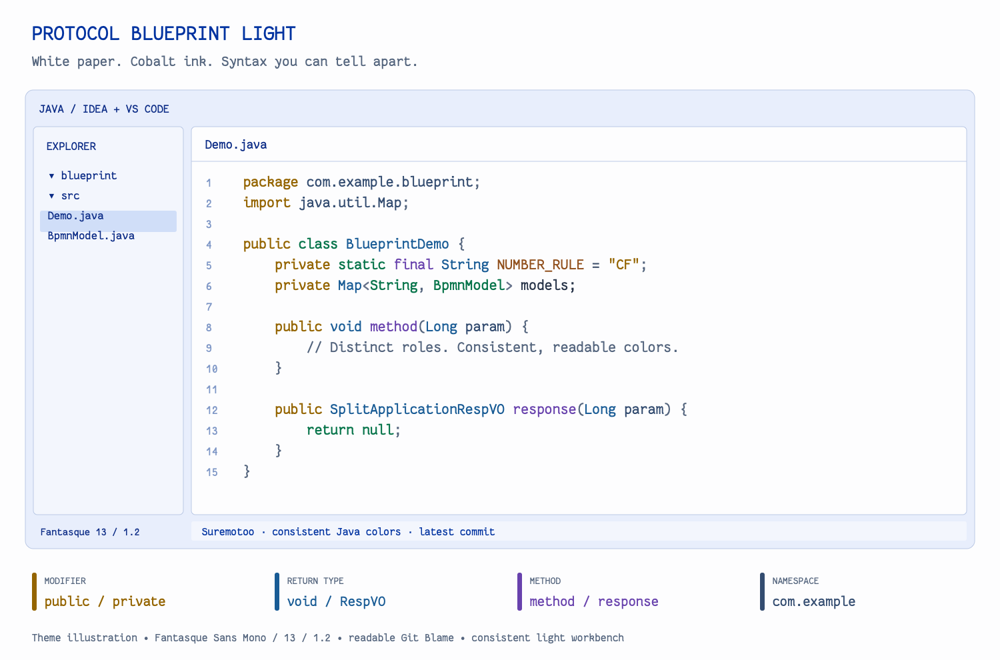

# Protocol Blueprint Light

A complete light workbench theme with near-white paper, cobalt-blue controls and distinct syntax roles.

Illustration rendered from the actual theme palette; not an IDE screenshot. Other extensions, file icons and shell prompts can change your setup's appearance.

## Activate

Install the extension, then run **Preferences: Color Theme** and select **Protocol Blueprint Light**. Reload Window after updating.

## Highlights

- Amber Java modifiers, blue return types, violet methods: neighboring roles stay distinct.
- Context-aware modifier chains, such as `private static final`.
- Blue containers, green generic arguments and neutral slate brackets.
- Blue-gray parameters and package/import paths.
- Readable Git Blame, CodeLens and optional GitLens colors.

## Fonts

Install **Fantasque Sans Mono** separately. Defaults: editor/terminal size **13**, line height **1.2**, editor ligatures enabled. Existing user/workspace settings take precedence; merge `settings.json` if needed. Font defaults apply while the extension is enabled, including with another theme.

## Java coloring

Java uses the native TextMate grammar and a narrow modifier-chain injection. A Java-only default disables `editor.semanticHighlighting.enabled` because the Java language server groups some distinct words into the same modifier token. This changes coloring only; completion, navigation and diagnostics remain available. Explicit Java user/workspace settings override this default. The default also applies to Java with other themes while this extension is enabled; other languages retain semantic highlighting. Re-enabling Java semantic colors may flatten declaration-word distinctions. All six bracket-pair colors in this theme are neutral slate.

## Source and support

[Source](https://github.com/Suremotoo/protocol-blueprint-light/tree/release-idea-1.1.1-vscode-1.1.2/vscode) · [Report an issue](https://github.com/Suremotoo/protocol-blueprint-light/issues) · [Companion IDEA theme](https://plugins.jetbrains.com/plugin/35816-protocol-blueprint-light).

Build from the repository root: `python3 scripts/build.py vscode` (Python 3.9+, Node.js 20+, npm). MIT license; fonts are not bundled.
